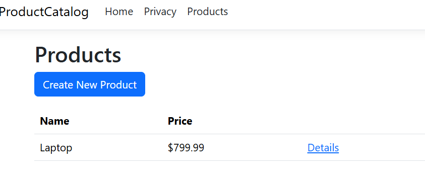
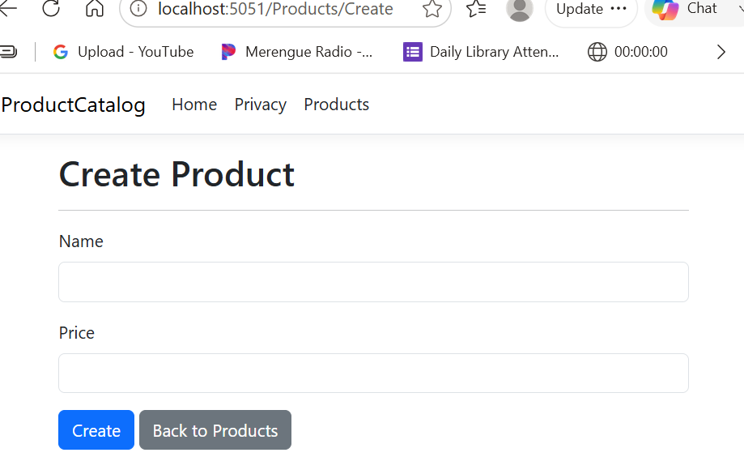

# ProductCatalog

ProductCatalog is an ASP.NET Core MVC application that displays a small catalog of products.

## Features

- View a list of products
- View product details
- Create new products
- Save products to a JSON file
- Validate that the product name is required
- Validate that the product price is between $0.01 and $1000.00
- Navigate to the Products page from the main navigation bar

## Technologies Used

- ASP.NET Core MVC
- C#
- Razor Views
- JSON
- Bootstrap

## Product Index

The Products page displays the products saved in the catalog.

## Create Product

The Create page allows a user to enter a product name and price.

## Data Storage

Product information is stored in:

`data/products.json`
